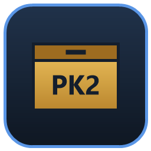

# pk2-mixer

<div align="center">
  
</div>

`pk2-mixer` is a cross-platform (Windows / Linux / macOS) manager for the `.PK2`
archives used by **Railroad Tycoon II**, written in C# / .NET 8 with an Avalonia
UI. The project is inspired by the famous Red Alert 2/Tiberian Sun file-processing tool **XCC Mixer**. The file-format handling is a fresh implementation of the behaviour documented
in the local [`spec/`](spec/) folder:

| Spec | Used for |
|------|----------|
| [`01-archive-pk2.md`](spec/01-archive-pk2.md) | PK2 index layout, recovered name hash, name catalogue |
| [`03-localization-lng.md`](spec/03-localization-lng.md) | `.lng` parser for the preview pane |
| [`08-image-bank.md`](spec/08-image-bank.md) | `.imb` groups/frames, raw + row-RLE pixels, `PALT` palettes, `FLATC`/`rgbto` tables |

The files in [`spec/`](spec/) are verbatim copies of the upstream research
documents, kept with the app so the format notes travel with the source. The
complete research set — including the generated `07-asset-names.md` catalogue
used for the embedded name table — lives in
[`../railroad-tycoon-2-decomp/rt2/spec`](../railroad-tycoon-2-decomp/rt2/spec).
Links inside the copied files are kept verbatim: they are relative to that
upstream tree, so some may not resolve from this folder.

The app itself contains only new code; the game's assets and binaries are not
part of this repository.

Starting the app with a `.PK2` archive or a folder as its first argument opens
that location in the left pane (`pk2-mixer "data/RT2.PK2"`), which makes "Open
with…" integration straightforward.

## Features

**Toolbar (menu bar)**

* **File ▸ New .PK2…** — create an empty PK2 archive (the canonical contiguous
  layout the retail engine reads).
* **File ▸ Open .PK2…** — open one or more `.PK2` / `.PAK` archives.
* **File ▸ Find Railroad Tycoon II archives** — searches `RT2_GAME_DIR`,
  `RT2_MAP`, the usual retail/GOG/Steam folders on all three platforms, Steam
  library folders and the common game folders on every fixed drive, then offers
  a folder picker if nothing is found.
* **File ▸ Found** — one sub-item per discovered archive, labelled with a
  shortened file address (relative to the installation, middle directories
  elided). The list is persisted in the settings file.
* **View ▸ Palette ▸ Load…** — scans a Railroad Tycoon II folder (loose files
  *and* inside its PK2 archives) for every palette-like asset:
  `PALTnnnn.PAL` shade ramps, `defaulN.pal` screen palettes, `FLATC16/8*.DAT`
  shading ramps and `rgbto8N.dat` conversion tables.
* **View ▸ Palette ▸ Select…** — picks the palette used to preview `.IMB`
  assets, with a swatch preview, search and a Browse button for a single file.

**Three columns**

* Two independent explorers. Each shows **name**, **filetype** and
  **size (bytes)** columns (resizable, sortable, reorderable) and can point at a
  PK2 archive or a folder on disk.
* Per-pane actions: open archive, open folder, up, save, import files,
  **copy to the other pane**, and **copy `.IMB` as extracted PNG**.
  Copying works archive → folder, folder → archive, archive → archive and
  folder → folder; archive targets are re-saved immediately after the copy and
  an entry with the same name hash is replaced instead of duplicated.
* The third column previews the selected asset:
  * `.IMB` (and `.BIN` that parses as an image bank) — group selector, frame
    rendering or a whole-bank contact sheet, per-group `PALT` colour, and an
    `Export PNG…` button;
  * `.DAT` / `.PAL` — palette swatches, FLATC shade ramps (16-bit RGB555 and
    8-bit) and `rgbto` tables;
  * `.LNG` — parsed string id / text table;
  * anything else — an offset + hex + ASCII dump.

**Palette resolution for image banks**: a palette chosen with
View ▸ Palette ▸ Select is an explicit override and is used for every group.
Without an override the documented engine order applies: the bank's own
`PALTnnnn.PAL` from the same archive, a loose file next to a folder asset,
another open archive, the loaded palette library, and finally a grayscale
fallback. View ▸ Palette ▸ Use each bank's own PALT clears the override.

## Requirements

* [.NET 8 SDK](https://dotnet.microsoft.com/download) to build (or the .NET 8
  runtime to run a framework-dependent build).
* Windows 10/11, a modern Linux desktop (X11/Wayland) or macOS 11+.
* No game installation is required to start the app; without one you can still
  create/open archives and work with loose files.

## Build, test, run

```sh
dotnet build pk2-mixer.sln
dotnet run --project tests/Pk2Mixer.Tests/Pk2Mixer.Tests.csproj   # 37 tests
dotnet run --project src/Pk2Mixer.App/Pk2Mixer.App.csproj
```

The tests are dependency-free and cover the recovered hash vectors, PK2
read/write round-trips, IMB parsing and both pixel encodings, PALT/FLATC/rgbto
decoding, the PNG writer, LNG parsing, install detection, copy operations and
palette resolution.

Four more tests validate real retail data when `PK2MIXER_RT2_DIR` points at a
folder of extracted assets (for example the research project's
`pk2_extracted/Railroad Tycoon 2 Platinum/RT2`):

```sh
PK2MIXER_RT2_DIR="/path/to/pk2_extracted/Railroad Tycoon 2 Platinum/RT2" \
    dotnet run --project tests/Pk2Mixer.Tests/Pk2Mixer.Tests.csproj
```

Those tests parse **every** `.imb` in the folder and decode every group's first
frame, load every `.pal`/`.DAT` palette, render `ground.imb` with `PALT0058`,
and round-trip a PK2 built from retail files. On the Platinum extraction used
during development that is 1,476 banks / 11,190 groups / 29,140 frames and 740
palette files, all parsing cleanly.

## Distribution builds

`tools/dist.ps1` builds the release artifacts. It runs on Windows PowerShell 5.1
and PowerShell 7+, and drives the native helpers where needed:

| Command | Result |
|---------|--------|
| `tools/dist.ps1 -Targets windows` | `dist/win-x64/pk2-mixer-<ver>-win-x64-portable.zip` — self-contained single-file `Pk2Mixer.exe` (no installer, no .NET install) |
| `tools/dist.ps1 -Targets linux` | `dist/linux-x64/pk2-mixer-<ver>-linux-x64.AppImage` and a portable `.tar.gz` |
| `tools/dist.ps1 -Targets macos` | `dist/osx-<arch>/pk2-mixer-<ver>-macos-<arch>.zip` (contains `pk2-mixer.app`) and a `.dmg` when run on macOS |
| `tools/dist.ps1 -Targets all` | everything the current host can build |
| `tools/dist.ps1` (no targets) | `windows` + `linux` on Windows, `linux` on Linux, `macos` on macOS |

Examples:

```powershell
# Windows: portable exe and the Linux AppImage (through WSL)
pwsh tools/dist.ps1

# Only the Windows portable archive
pwsh tools/dist.ps1 -Targets windows

# Linux AppImage on a Linux machine
pwsh tools/dist.ps1 -Targets linux

# macOS: ad-hoc signed .app + .zip + .dmg for both architectures
pwsh tools/dist.ps1 -Targets macos -MacArchitectures arm64,x64

# Cross-built, unsigned macOS bundle for inspection (sign on a Mac before use)
pwsh tools/dist.ps1 -Targets macos -AllowUnsignedMacOS
```

On Linux/macOS, `tools/dist.sh` is a thin wrapper that finds `pwsh` and forwards
the arguments.

### How the targets are packaged

* **Windows** — `dotnet publish -r win-x64 --self-contained true` with
  `PublishSingleFile`, `IncludeNativeLibrariesForSelfExtract` and
  `EnableCompressionInSingleFile`. The ZIP also contains the README and
  third-party notices.
* **Linux AppImage** — a self-contained folder publish is wrapped in an AppDir
  (`AppRun`, `pk2-mixer.desktop`, hicolor icon, docs) and packed with
  `appimagetool`; the tool is downloaded to `~/.cache/pk2-mixer` on first use and
  run with `--appimage-extract-and-run`, so no FUSE is needed on the build host.
  On Windows the build runs through WSL (`-WslDistro` selects the distro; the
  first installed one is used by default). A portable `.tar.gz` is produced as
  well for systems where AppImages cannot run.
* **macOS** — a self-contained `osx-<arch>` publish is assembled into
  `pk2-mixer.app` with an `Info.plist` and an `.icns` generated from
  `assets/pk2-mixer.png`; the bundle is ad-hoc signed (`codesign --force --deep
  --sign -`), zipped with `ditto` and packed into a `.dmg` with `hdiutil`.
  Replace the ad-hoc signature with your Developer ID for public distribution.
  macOS artifacts must be built on macOS; `-AllowUnsignedMacOS` only exists for
  cross-build checks and produces a ZIP whose executable bit is preserved but
  which still needs `codesign` on a Mac before it will launch on Apple Silicon.

Every run refreshes `dist/SHA256SUMS.txt` and writes `dist/README.txt` with the
artifact list and run instructions.

### Continuous integration

`.github/workflows/dist.yml` builds the same artifacts on native GitHub runners
(`windows-latest`, `ubuntu-24.04`, `macos-14`) on `workflow_dispatch` and on
`v*` tags. Tag builds download all artifacts and attach them (plus
`SHA256SUMS.txt`) to the GitHub release.

### Manual publish

The script is the recommended path, but plain `dotnet publish` works too:

```sh
dotnet publish src/Pk2Mixer.App -c Release -r win-x64   --self-contained true \
    -p:PublishSingleFile=true -p:IncludeNativeLibrariesForSelfExtract=true -o dist/win-x64
dotnet publish src/Pk2Mixer.App -c Release -r linux-x64 --self-contained true -o dist/linux-x64
dotnet publish src/Pk2Mixer.App -c Release -r osx-arm64 --self-contained true -o dist/osx-arm64
```

The Avalonia desktop backend is selected at run time by `UsePlatformDetect()`;
native file/folder pickers come from `Window.StorageProvider` on every platform.


## Projects

```
pk2-mixer/
├── pk2-mixer.sln
├── README.md
├── spec/                       local copies of the three format specs above
├── src/
│   ├── Pk2Mixer.Core/          format readers/writers, no UI dependencies
│   │   ├── Assets/             Pk2Archive, ImbBank, ImbFrameDecoder, palettes,
│   │   │                       LngFile, PNG writer, preview builders
│   │   ├── Graphics/           RGBA images + IMB frame decoding
│   │   ├── Locations/          folder/archive abstraction used by both panes
│   │   ├── AssetOperations.cs  copy raw / copy as PNG
│   │   ├── PaletteResolver.cs  per-group PALT lookup chain
│   │   ├── PaletteLibrary.cs   .DAT/.FLATC/PALT discovery
│   │   ├── Rt2InstallFinder.cs install + archive discovery
│   │   ├── AppSettings.cs      JSON settings (%APPDATA%, ~/.config, ~/Library)
│   │   └── Resources/asset-names.txt   hash → name catalogue (2,396 names)
│   └── Pk2Mixer.App/           Avalonia UI
│       ├── ViewModels/         explorer panes, preview, palette dialog, main VM
│       ├── Views/              MainWindow, ExplorerPaneView, PreviewPaneView,
│       │                       PaletteSelectWindow
│       └── Services/           RgbaImage → Avalonia Bitmap
├── tests/Pk2Mixer.Tests/       dependency-free console test runner
├── assets/                     app icon (PNG/ICO), third-party notices,
│                               distribution README template
├── .github/workflows/dist.yml  native Windows/Linux/macOS release builds
└── tools/
    ├── dist.ps1                release build orchestrator (all targets)
    ├── dist.sh                 Unix wrapper for dist.ps1
    ├── make-appimage.sh        AppDir → AppImage (appimagetool, no FUSE)
    ├── make-macos-bundle.sh    .app + icns + codesign + zip + dmg
    ├── make-icons.ps1          regenerates assets/pk2-mixer.png/.ico
    └── smoke.ps1               GUI start/stop smoke check (Windows)
```

## Format notes and limitations

* **PK2 stores no file names, only 32-bit hashes.** The app resolves names with
  the catalogue recovered from the retail executable
  ([`07-asset-names.md`](../railroad-tycoon-2-decomp/rt2/spec/07-asset-names.md),
  embedded as `asset-names.txt`). Entries the
  catalogue does not cover are shown as `entry_NNNN`, with the filetype sniffed
  from the payload (IMB banks are recognised by their group count). For those,
  the app cannot restore a name after the archive is re-opened — the format
  simply does not carry one.
* **Writes are canonical.** New/imported entries are appended in the verified
  contiguous layout (`dataStart = 4 + count * 12`). Legacy `.PAK` files are read
  with the `u16` index layout but always written back as modern PK2.
* **IMB transparency.** Palette index 0 is the blitter's transparency key
  (spec 08), and the RLE alpha-overlay spans are exported transparent too, so
  PNGs have a real alpha channel. Contact-sheet cells keep the documented
  2-pixel margin.
* **PNG export** is one contact sheet with each group's first (zoom-0) frame,
  12 tiles per row, capped at 4096 px. `Export PNG…` on the preview exports the
  current group, or the whole sheet when the `sheet` box is checked.
* **`rgbto8N.dat`** is 32,768 bytes, i.e. 256 entries wide × 128 rows; the
  preview shows it in that shape.
* **Palette shade 16** (the engine's neutral sprite row) is used for previews;
  the preview header names the resolved palette.
* **No per-entry editing yet** — the tool copies, imports and re-saves whole
  entries, which is what the archive format supports.

## Settings

Stored as JSON in:

| OS | Path |
|----|------|
| Windows | `%APPDATA%\Pk2Mixer\settings.json` |
| Linux | `$XDG_CONFIG_HOME/Pk2Mixer/settings.json` (or `~/.config/Pk2Mixer/…`) |
| macOS | `~/Library/Application Support/Pk2Mixer/settings.json` |

It holds the discovered archive list, the last palette folder and the selected
preview palette. A corrupt settings file never prevents startup.

## Regenerating the name catalogue

`src/Pk2Mixer.Core/Resources/asset-names.txt` is generated from the research
folder (one `hash name` pair per line). That catalogue (`07-asset-names.md`) is
not copied into this repository; the script reads it from the research tree:

```powershell
$src = '..\railroad-tycoon-2-decomp\rt2\spec\07-asset-names.md'
$rx  = [regex]'^\|\s*\d+\s*\|\s*`([0-9a-fA-F]{8})`\s*\|\s*\d+\s*\|\s*`([^`]+)`'
$names = foreach ($line in [IO.File]::ReadAllLines($src)) {
    $m = $rx.Match($line)
    if ($m.Success) { "$($m.Groups[1].Value.ToLowerInvariant()) $($m.Groups[2].Value)" }
}
[IO.File]::WriteAllLines('src\Pk2Mixer.Core\Resources\asset-names.txt', $names,
    (New-Object System.Text.UTF8Encoding($false)))
```

## Troubleshooting

* **`An Application Control policy has blocked this file` (0x800711C7) when
  running a fresh build on Windows.** Smart App Control / WDAC can block newly
  built, unsigned DLLs in some folders (for example under `Documents`). Copy the
  output folder (e.g. `tests/Pk2Mixer.Tests/bin/Debug/net8.0`) somewhere else
  such as `%TEMP%` and run it from there, or allow the folder in your policy.
  This is a Windows policy decision, not an application error.
* **No archives found.** Set `RT2_GAME_DIR` to the installation folder before
  starting, or use *Find* and then pick the folder manually; archives are found
  recursively by extension (`.pk2` / `.pak`).
* **A bank renders grey.** No `PALTnnnn.PAL` could be resolved. Load the
  installation's palettes with *View ▸ Palette ▸ Load…* or pick one with
  *Select…*; the preview header always names the palette actually used.

## Legal

The tool is intended for interoperability and preservation work on a legally
owned copy of Railroad Tycoon II. Game code, assets and trademarks remain the
property of their owners; this repository contains only new source code and
references the format documentation in the research folder. The copies in
[`spec/`](spec/) are the project's own clean-room format notes, kept locally so
the implementation and its documentation stay together.
